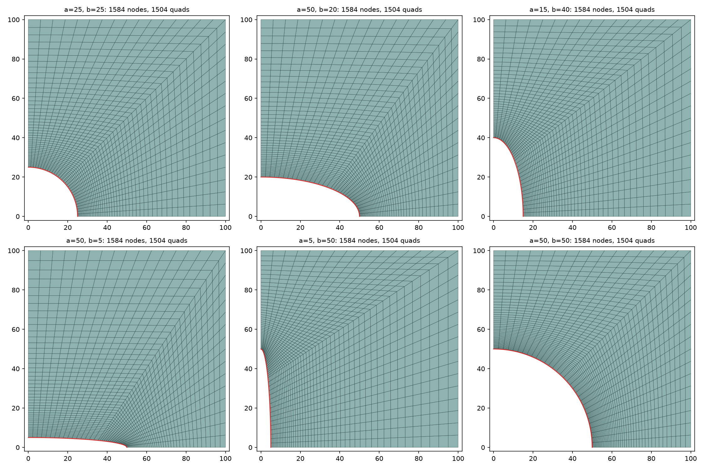

# Geo-FNO for a 2D plane-stress plate with an elliptical hole

A self-contained Geometry-aware Fourier Neural Operator (Geo-FNO) toolkit for
predicting the displacement and stress field in a square plate with a central
elliptical hole. It contains:

1. a **gmsh mesh generator** that produces structured quad meshes with the
   *same number of nodes and elements for every hole shape*,
2. a **Geo-FNO model** that maps mesh coordinates (+ optional material/load
   features) to displacements,
3. a **plane-stress postprocessor** that turns displacements into strain,
   stress and von Mises stress on the curved mesh.

There is no dataset loader, training loop or trained model yet. These depend on
the FEM results you generate on the meshes (see [Workflow](#workflow)).



---

## Contents

- [Folder layout](#folder-layout)
- [Installation](#installation)
- [Quick start](#quick-start)
- [Workflow](#workflow)
- [1. Mesh generation (`gmsh_plate_mesh.py`)](#1-mesh-generation-gmsh_plate_meshpy)
- [2. Grid convention](#2-grid-convention)
- [3. Model (`model.py`)](#3-model-modelpy)
- [4. Plane-stress mechanics (`physics.py`)](#4-plane-stress-mechanics-physicspy)
- [5. Analytic meshes (`geometry.py`)](#5-analytic-meshes-geometrypy)
- [6. Full ring vs. quarter model](#6-full-ring-vs-quarter-model)
- [7. Preparing your dataset](#7-preparing-your-dataset)
- [Tests](#tests)
- [Limitations and next steps](#limitations-and-next-steps)

---

## Folder layout

| File | Purpose |
|---|---|
| `gmsh_plate_mesh.py` | gmsh generator for the doubly symmetric quarter plate (CLI + `build_plate_mesh`). Needs only `gmsh` and `numpy`. |
| `model.py` | `SpectralConv2d` and `PlaneStressGeoFNO` (PyTorch). |
| `physics.py` | `plane_stress_fields`: strain, stress and von Mises from displacement. |
| `geometry.py` | `computational_grid` and `make_plate_mesh`: analytic (gmsh-free) meshes for tests and demos. |
| `demo.py` | Forward pass of an **untrained** model on full-ring and quarter meshes. |
| `test_core.py` | Unit tests for geometry, mechanics and model. |
| `plate with hole mesh.png` | Reference mesh layout the gmsh generator follows. |
| `plate_meshes_example.png` | Example output of the gmsh generator. |
| `requirements.txt` | Python dependencies. |

`import plane_stress_geofno` exposes `computational_grid`, `make_plate_mesh`,
`PlaneStressGeoFNO` and `plane_stress_fields`. Importing never starts a run or
requires CUDA.

## Installation

```bash
python3 -m pip install -r plane_stress_geofno/requirements.txt
```

| Package | Needed for |
|---|---|
| `torch>=2.0` | model, mechanics, tests, demo |
| `gmsh>=4.11`, `numpy` | mesh generation |
| `matplotlib` | `--plot` figures only |

Verified with Python 3.14.4, PyTorch 2.14.1 (CPU), gmsh 4.15.2, NumPy 2.5.2.

## Quick start

All commands run from the **repository root** (the folder that contains
`plane_stress_geofno/`).

```bash
# 1. Generate meshes for 500 random elliptical holes (semi-axes 5-50 mm)
python3 plane_stress_geofno/gmsh_plate_mesh.py --samples 500 --seed 0 --out plate_meshes --plot

# 2. Run the untrained demo and the unit tests
python3 -m plane_stress_geofno.demo
python3 -m unittest -v plane_stress_geofno.test_core
```

```python
import numpy as np, torch
from plane_stress_geofno import PlaneStressGeoFNO, plane_stress_fields

d = np.load("plate_meshes/plate_meshes.npz")
coords = torch.tensor(d["coords"], dtype=torch.float32)       # [N, 33, 48, 2] in mm

model = PlaneStressGeoFNO(condition_channels=0, modes_theta=8, modes_radial=12,
                          periodic=False)                     # quarter model
u = model(coords / 100)                                       # [N, 33, 48, 2]  (ux, uy)
fields = plane_stress_fields(u, coords, young_modulus=210e3, poisson_ratio=0.3,
                             periodic=False)
fields["stress"]      # [N, 33, 48, 3]  sxx, syy, txy
fields["von_mises"]   # [N, 33, 48]
```

(The model is untrained here, so the numbers are meaningless. The snippet only
shows the interfaces.)

## Workflow

```text
 gmsh_plate_mesh.py            your FEM solver              PlaneStressGeoFNO
 ──────────────────            ───────────────              ─────────────────
 (a, b) ──► plate_XXXX.msh ──► displacement / stress ──►  train: coords → (ux, uy)
        └─► plate_meshes.npz   at the SAME nodes            │
            coords [N,T,R,2]                                ▼
                                                       plane_stress_fields
                                                       (ux, uy) → strain, stress, von Mises
```

1. Generate meshes with `gmsh_plate_mesh.py`.
2. Solve each `.msh` in your FEM code using the named boundary groups. Use
   symmetry conditions on the cut edges and your load on the outer edges.
3. Store the nodal displacement (and stress, if you want to supervise it) in
   the same node order as `coords` (see [section 7](#7-preparing-your-dataset)).
4. Train `PlaneStressGeoFNO` to predict displacement from coordinates.
5. Recover strain and stress with `plane_stress_fields`.

---

## 1. Mesh generation (`gmsh_plate_mesh.py`)

### Geometry

- The full plate is `plate_size × plate_size` (default **200 × 200 mm**) with a
  central elliptical hole of semi-axes `a` (along x) and `b` (along y).
- The problem is symmetric about both axes, so only the **quarter**
  `[0, 100] × [0, 100]` is meshed. The quarter-ellipse hole sits at the origin
  corner.
- Each semi-axis must lie in `(0, 50]` mm (`--max-semi-axis`). This leaves a
  ligament of at least 50 mm and keeps the elements well shaped.

### Mesh layout

The layout follows `plate with hole mesh.png`. A diagonal from the hole point at
parametric angle 45° to the plate corner `(100, 100)` splits the quarter into
**two four-sided patches**. Each patch is a gmsh *transfinite* (mapped) surface
recombined into quads:

```text
 (0,100) ────── top ─────── (100,100)
    │  ╲                    ╱ │
 sym_x0   patch 2       ╱     │
    │       ╲       diagonal  right
  (0,b)       ╲    ╱   patch 1│
     ╲  hole   ╲ ╱            │
      ╲________(a,0)──sym_y0──(100,0)
```

| Edge | Nodes | Spacing |
|---|---|---|
| Hole arc and outer edge of each patch | `n_arc` (default 17) | uniform |
| Hole → outer edge (both symmetry edges and the diagonal) | `n_radial` (default 48) | geometric, ratio `progression` (default 1.05), finest at the hole |

The divisions are fixed, so **every mesh has identical counts and connectivity**.
Only the node positions move with `a` and `b`:

| Quantity | Formula | Default |
|---|---|---|
| Structured grid `T × R` | `(2·(n_arc−1)+1) × n_radial` | 33 × 48 |
| Nodes | `T · R` | **1,584** |
| Quad elements | `2·(n_arc−1)·(n_radial−1)` | **1,504** |

The script checks every generated mesh and stops with an error if any mesh
differs in node count or connectivity, or has an inverted element.

### Command line

```bash
python3 plane_stress_geofno/gmsh_plate_mesh.py [options]
```

| Option | Default | Meaning |
|---|---|---|
| `--a A [A ...]`, `--b B [B ...]` | six example shapes | explicit semi-axes, one pair per mesh |
| `--samples N` | 0 | if > 0, draw N random `(a, b)` pairs instead |
| `--range LO HI` | 5 50 | uniform range for random semi-axes (mm) |
| `--seed S` | 0 | random seed |
| `--plate-size` | 200 | side of the **full** plate; the quarter meshed is half of it |
| `--max-semi-axis` | 50 | largest allowed semi-axis |
| `--n-arc`, `--n-radial` | 17, 48 | mesh density (fixed for the whole dataset) |
| `--progression` | 1.05 | radial growth ratio; use about 1.03 for squarer elements at the hole |
| `--out DIR` | `plate_meshes` | output folder |
| `--plot` | off | save `plate_meshes.png` with the first 9 meshes |

### Outputs (in `--out`)

| File | Contents |
|---|---|
| `plate_0000.msh`, … | one gmsh mesh per hole, with the physical groups below |
| `plate_meshes.npz` | `a`, `b` `[N]`; `plate_size`; `coords [N,T,R,2]` (grid order); `nodes [N,1584,2]` (mesh order); `quads [1504,4]` (shared connectivity, indices into `nodes`); `grid_index [T,R]` (grid position → node index) |
| `plate_meshes.png` | with `--plot` only |

Physical groups in every `.msh`, for FEM boundary conditions:

| Group | Location | Typical BC |
|---|---|---|
| `sym_y0` | edge `y = 0`, from hole to `x = 100` | `uy = 0` |
| `sym_x0` | edge `x = 0`, from hole to `y = 100` | `ux = 0` |
| `right` | edge `x = 100` | load or free |
| `top` | edge `y = 100` | load or free |
| `hole` | quarter ellipse | traction-free |
| `plate` | the surface | material |

### Python use

```python
import gmsh
from plane_stress_geofno.gmsh_plate_mesh import build_plate_mesh

gmsh.initialize()
mesh = build_plate_mesh(40.0, 20.0, msh_path="plate.msh")   # a=40, b=20 mm
gmsh.finalize()
mesh["coords"].shape, mesh["nodes"].shape, mesh["quads"].shape   # (33,48,2) (1584,2) (1504,4)
```

Run the script **by file path** as shown above if PyTorch is not installed.
`python3 -m plane_stress_geofno.gmsh_plate_mesh` imports the package
`__init__`, which imports torch.

### How the structured order is recovered

gmsh numbers nodes in its own order. `_structured_order` rebuilds the
`[T, R]` grid from the quad connectivity:

1. Ring 0 is the hole, walked from the `y = 0` edge to the `x = 0` edge.
2. Each node in ring `j` has exactly one neighbour outside rings `j−1` and `j`.
   That neighbour is its node in ring `j+1`.

The result is `grid_index`, and `coords = nodes[grid_index]`.

## 2. Grid convention

Every mesh is a structured array `[T, R, 2]` of physical `(X, Y)`:

| Index | Quarter model (`periodic=False`) | Full ring (`periodic=True`) |
|---|---|---|
| `i = 0` | on the `y = 0` symmetry edge (+x axis) | on the +x axis |
| `i` increasing | counter-clockwise | counter-clockwise |
| `i = T−1` | on the `x = 0` symmetry edge (+y axis) | one step before +x; the seam is not duplicated |
| `j = 0` | hole boundary | hole boundary |
| `j = R−1` | outer plate edge | outer plate edge |

The FFT runs over the **indices** `(i, j)`, which form a uniform rectangle even
though the physical mesh is curved. Geometry reaches the network through the
`(X, Y)` input channels. This is a **known-mapping Geo-FNO**, like
`airfoils/naca_geofno.py`. It does not learn a deformation the way
`elasticity/elas_geofno.py` does. Every sample must therefore use the same
`T × R`, the same ordering and the same `radial_power`/`progression`.

## 3. Model (`model.py`)

```python
PlaneStressGeoFNO(condition_channels=0, width=32, modes_theta=16, modes_radial=12,
                  depth=4, radial_padding=8, periodic=True)
model(coords [B,T,R,2], conditions [B,T,R,C] or None) -> displacement [B,T,R,2]
```

Data flow:

```text
inputs  [X, Y, position features, conditions...]          [B,T,R, 2+P+C]
  │  Linear lift                                           [B,T,R, width]
  │  zero-pad: radial axis always; angular axis if periodic=False
  │  depth × { v = SpectralConv(v) + Conv1x1(v);  GELU (except last block) }
  │  crop padding
  │  Linear(width→128) → GELU → Linear(128→2)
outputs [ux, uy]                                           [B,T,R,2]
```

- **Position features `P`:** `cos 2πξ, sin 2πξ, η` when `periodic=True`
  (3 channels, no jump at the seam). `ξ, η` when `periodic=False` (2 channels).
- **`SpectralConv2d`:** `rfft2` over `(angle, radius)`. It learns complex
  channel-mixing weights for the lowest `modes_theta` positive and negative
  angular frequencies and the lowest `modes_radial` radial frequencies. All
  higher modes are dropped in this branch, and the 1×1 convolution keeps local
  detail. It raises an error if the modes do not fit the padded grid.
- **Padding:** zero padding (default 8 nodes) on non-periodic axes reduces FFT
  wrap-around between opposite edges. It is not a boundary condition.
- **Conditions:** any per-node features you choose, for example `E`, `ν`, load
  magnitude or boundary flags, broadcast to `[B,T,R,C]`. The model does not
  interpret channel meanings.
- For the 33 × 48 quarter grid, use `modes_theta ≈ 8`.

## 4. Plane-stress mechanics (`physics.py`)

```python
plane_stress_fields(displacement, coords, young_modulus, poisson_ratio, *,
                    periodic=True, jacobian_tolerance=1e-10)
-> {"strain": [B,T,R,3], "stress": [B,T,R,3], "von_mises": [B,T,R]}
```

Assumptions: small strain, linear isotropic elasticity, plane stress
(`σzz = τxz = τyz = 0`).

**Derivatives on the curved mesh.** Differences are taken in index space and
mapped to physical space with the mesh Jacobian:

```text
angular:  periodic centred differences (full ring), or
          2nd-order differences, one-sided at the symmetry edges (quarter)
radial:   2nd-order differences, one-sided at hole and outer edge

J   = X_ξ Y_η − X_η Y_ξ
f_X = (Y_η f_ξ − Y_ξ f_η) / J
f_Y = (X_ξ f_η − X_η f_ξ) / J
```

**Constitutive law:**

```text
εxx = ux_X     εyy = uy_Y     γxy = ux_Y + uy_X     (engineering shear)
σxx = E/(1−ν²) (εxx + ν εyy)
σyy = E/(1−ν²) (εyy + ν εxx)
τxy = E/(2(1+ν)) γxy
σvm = sqrt(σxx² − σxx σyy + σyy² + 3 τxy²)
```

- `E` and `ν` may be scalars or broadcastable to `[B,T,R]`. Use `[B,1,1]` for
  per-sample values. Use consistent units, for example mm and MPa.
- If coordinates or displacements were normalised for training, undo that
  before calling this function.
- Errors are raised for non-finite or out-of-range `E`/`ν`, near-singular
  Jacobians, and folded meshes. Calling it with `periodic=True` on a quarter
  grid triggers the fold check ("Mesh orientation changes").
- Everything is differentiable, so a training loss can supervise stress as
  well as displacement.

## 5. Analytic meshes (`geometry.py`)

A gmsh-free alternative, used by the tests and the demo:

```python
make_plate_mesh(n_theta, n_radial, plate_size=(W, H), hole="circle"|"ellipse"|"superellipse",
                hole_size=(a, b), exponent=4.0, rotation=0.0, radial_power=1.0,
                hole_radius=None, quarter=False)
```

Each node lies on a ray from the centre, blended between the hole and the
rectangular edge:
`r(θ, η) = (1 − η^p)·r_hole(θ) + η^p·r_outer(θ)`.
`quarter=True` returns the doubly symmetric quarter on `θ ∈ [0, π/2]`, and then
`rotation` must be 0. The grid ordering matches the gmsh meshes, but the interior
node positions differ, because gmsh uses transfinite interpolation with a
diagonal. Do not mix the two generators in one dataset.

## 6. Full ring vs. quarter model

| | Full ring | Quarter (recommended for this plate) |
|---|---|---|
| Mesh source | `make_plate_mesh(...)` | `gmsh_plate_mesh.py` or `make_plate_mesh(..., quarter=True)` |
| Angular axis | periodic, wraps 0 → 2π | open, `y = 0` edge → `x = 0` edge |
| `periodic` flag | `True` (default) | **`False`** in both the model and `plane_stress_fields` |
| Angular padding / features | none / `cos, sin` | padded / `ξ` |
| Cost | 4× the nodes | ¼ of the nodes |
| Assumption | none | geometry **and loading** symmetric about both axes |

The symmetry conditions `uy = 0` on `y = 0` and `ux = 0` on `x = 0` belong to
the FEM model and therefore to the training targets. The network does not
impose them.

## 7. Preparing your dataset

Store the following for every sample, in grid order `[T, R]` (use
`grid_index` to reorder FEM nodal results):

| Quantity | Shape | Notes |
|---|---|---|
| Coordinates | `[T,R,2]` | `coords` from `plate_meshes.npz` |
| Displacement target | `[T,R,2]` | physical `ux, uy`, rigid-body motion removed by the BCs |
| Stress target (optional) | `[T,R,3]` | `σxx, σyy, τxy` in global axes |
| Conditions (optional) | `[T,R,C]` | material, load, boundary flags; your convention |

```python
# FEM nodal results in gmsh node order (ordered like plate_meshes.npz "nodes")
u_grid = u_nodes[d["grid_index"]]          # [T,R,2]
```

Notes:

- If material, load and supports are the same for every sample, coordinates
  alone are enough as input.
- For spatially varying boundary conditions, add explicit boundary-flag
  channels so that "zero load" and "unconstrained" are distinguishable.
- Check that your FEM node order matches the `.msh` file. Some converters
  renumber nodes.

## Tests

```bash
python3 -m unittest -v plane_stress_geofno.test_core
```

| Test | Checks |
|---|---|
| `test_mesh_boundaries` | analytic full-ring hole and outer boundaries |
| `test_rotated_and_custom_holes` | rotated ellipse, custom `hole_radius` |
| `test_affine_displacement_has_exact_constant_strain` | exact strain and stress for linear displacement (full ring) |
| `test_rigid_rotation_and_translation_have_zero_stress` | rigid-body motion gives zero stress |
| `test_forward_backward_and_resolution` | model shapes, gradients, two resolutions, input validation |
| `test_quarter_mesh_boundaries` | quarter mesh lies on both symmetry edges, the ellipse and the outer edges |
| `test_quarter_affine_strain_needs_open_angular_axis` | exact strain with `periodic=False`; `periodic=True` is rejected |
| `test_quarter_model_forward_backward` | quarter model shapes and gradients at two resolutions |

All 8 tests pass. The gmsh meshes were also checked separately: 306 hole
shapes all gave 1,584 nodes and 1,504 quads with identical connectivity, the
minimum scaled Jacobian was ≥ 0.88, and an affine displacement gave exact
strain to 3e-15 on 300 meshes.

These tests verify the implementation, not predictive accuracy.

## Limitations and next steps

- **No training yet.** A dataset loader, normalisation, loss (displacement
  and/or stress) and training loop still need to be written once the FEM data
  exists.
- **Stress concentration.** Peak stress at the hole is sensitive to mesh
  resolution and prediction noise. Validate against a circular-hole benchmark
  (`Kt ≈ 3` under uniaxial tension) and against FEM convergence.
- **Elongated holes** (for example `a = 50, b = 5`) produce steep gradients at
  the hole tip. Confirm FEM convergence for the most extreme shapes.
- **Scope:** one central, doubly symmetric hole in a square plate. Multiple
  holes, non-symmetric loads or rotated holes need the full-ring model or a
  different parameterisation.
- Plane stress and small strain only. Not plane strain, plasticity or large
  deformation.
